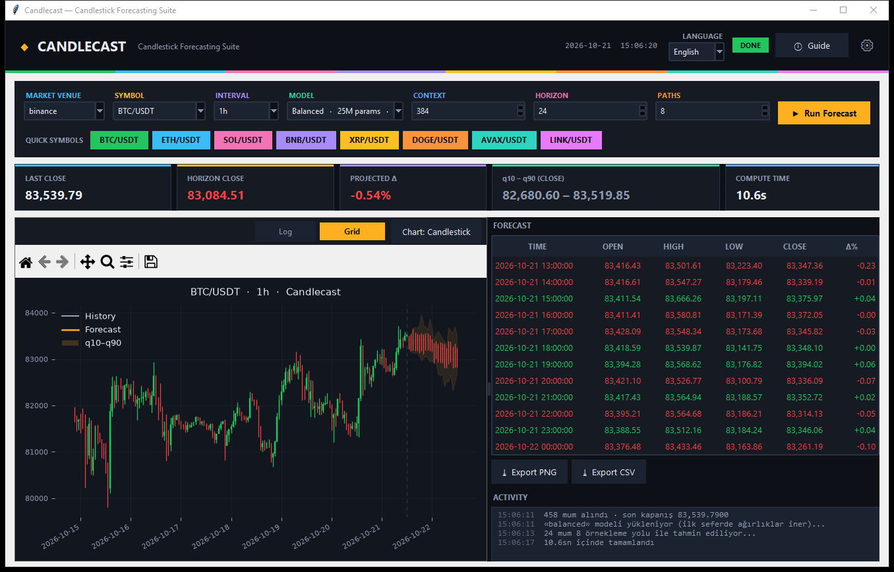
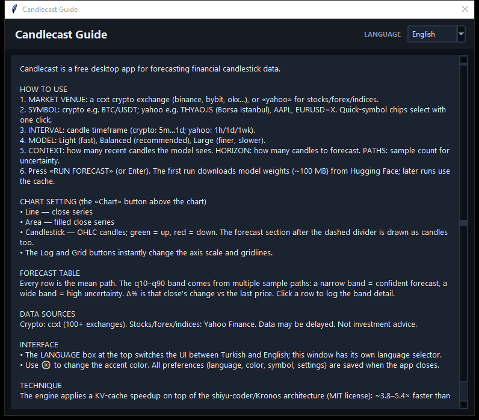
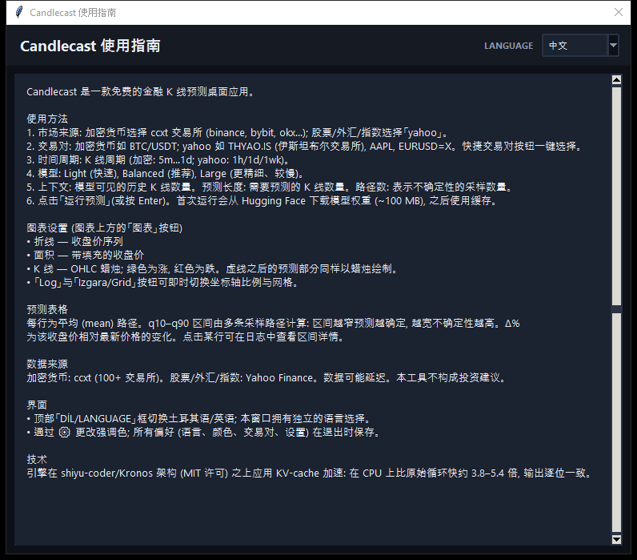

# Candlecast ⚡ — Premium Candlestick Forecasting Suite

[](LICENSE)
[](https://www.python.org/)
[](https://pytorch.org/)
[](https://huggingface.co/NeoQuasar)
[](#benchmarks)

**Candlecast** is a free, open-source **candlestick forecasting suite**: a KV-cache–accelerated transformer inference engine, a free market-data layer, and a premium dark desktop GUI — in one pip-installable Python package.

> **TL;DR** — Bit-exact forecasts **3.8–5.4× faster on CPU**, free crypto & stock data (ccxt + Yahoo Finance), q10–q90 uncertainty bands, Turkish / English UI with a 6-language in-app guide, packaged Windows `.exe`. Built on the [shiyu-coder/Kronos](https://github.com/shiyu-coder/Kronos) financial foundation model (MIT).

<p align="center">
  
</p>

## Table of contents

- [Why Candlecast](#why-candlecast)
- [Screenshots](#screenshots)
- [Features](#features)
- [Quickstart](#quickstart)
- [Free market data](#free-market-data)
- [Models & benchmarks](#models--benchmarks)
- [Python API](#python-api)
- [Testing](#testing)
- [Project structure](#project-structure)
- [Roadmap](#roadmap)
- [License](#license)

## Why Candlecast

- **🚀 Fast inference** — original Kronos-style decoding recomputes the whole context every step (`O(steps × context)`). Candlecast keeps a **KV cache + hidden-state cache per layer**, so each step processes **exactly one token**. Verified **bit-exact** (max diff `0.00e+00`) against the reference loop on CPU, GPU-ready.
- **💰 100% free data** — crypto OHLCV from **100+ exchanges** (Binance, Bybit, OKX, Kraken…), stocks/forex/indices from **Yahoo Finance** (Borsa Istanbul `.IS`, `AAPL`, `EURUSD=X`, `^XU100`…), plus stooq/CSV importers. No API keys, no paid feeds.
- **📊 Uncertainty quantification** — multi-path sampling → **q10 / q50 / q90** confidence bands on every forecast.
- **🕯 Valid candles, guaranteed** — post-prediction projection enforces `high ≥ max(open, close)`, `low ≤ min(open, close)`, `volume ≥ 0`, optional open-continuity.
- **🖥 Premium desktop GUI** — candlestick/line/area charts, log & grid toggles, quick-symbol chips, status pill, accent-color picker, PNG/CSV export, persistent preferences. UI in **Türkçe / English**, built-in guide in **6 languages (TR, EN, 中文, RU, ES, العربية)**.

## Screenshots

| | |
|:--:|:--:|
|  |  |
| **Main window — Türkçe** (candlestick forecast + KPI cards) | **Main window — English** (forecast table, Δ%, exports) |
|  |  |
| **In-app guide — English** | **In-app guide — 中文** |

## Features

**Inference engine**
- KV-cache autoregressive decoding with absolute-position reindexing + cache eviction (handles rolling windows and mid-window shifts — 4 equivalence test scenarios).
- `torch.inference_mode`, optional bf16/fp16 autocast.
- Top-k / top-p / temperature sampling; fixed a `top_k=None` crash found in upstream.
- OHLCV validity projection + return-based re-anchoring for wild jumps.

**Market data layer**
- `fetch_ccxt`, `fetch_yfinance`, `fetch_stooq`, `load_csv`, `next_timestamps` (gap-aware timestamp generation for 5m/15m/1h/4h/1d/1wk).

**Desktop app**
- Dark fintech theme, colorful accent strip, rainbow quick-symbol chips, status pill (READY/WORKING/DONE/ERROR).
- Chart modes: **Candlestick / Line / Area** with q10–q90 band; **Log** scale and **Grid** toggles.
- KPI cards: last close, horizon close, projected Δ%, q10–q90 band, compute time.
- PNG & CSV export, click-a-row band inspection, activity log.
- Settings persistence (`candlecast.config.json`), language & accent-color pickers.

## Quickstart

### Run the desktop app

```bash
git clone https://github.com/RetroNyym/candlecast.git
cd candlecast
python -m venv .venv
.venv\Scripts\activate          # Windows:  source .venv/bin/activate  (Linux/macOS)
pip install -r requirements.txt
python candlecast.py
```

The first forecast downloads model weights (~100 MB) from Hugging Face; everything afterwards is cached.

### Package a Windows executable

```bash
pip install pyinstaller
pyinstaller --noconfirm --clean --windowed --onedir --name Candlecast \
  --collect-all ccxt --collect-all yfinance --collect-submodules einops candlecast.py
# → dist/Candlecast/Candlecast.exe
```

## Free market data

| Source | Examples | Notes |
|---|---|---|
| **ccxt** | `BTC/USDT`, `ETH/USDT`, … on binance, bybit, okx, kraken, coinbase… | 100+ exchanges, OHLCV up to 1000 candles |
| **Yahoo Finance** | `THYAO.IS`, `GARAN.IS`, `ASELS.IS`, `^XU100` (BIST), `AAPL`, `NVDA`, `EURUSD=X`, `GC=F` | stocks, ETFs, forex, indices, futures |
| **stooq / CSV** | any local OHLCV file | offline / custom datasets |

## Models & benchmarks

All models load for free from Hugging Face (`NeoQuasar/Kronos-*`):

| Zoo key | Weights | Params | Default context |
|---|---|---|---|
| `light` | `NeoQuasar/Kronos-mini` | 4.1M | 2048 |
| `balanced` | `NeoQuasar/Kronos-small` | 24.7M | 512 |
| `large` | `NeoQuasar/Kronos-base` | 102.3M | 512 |

<a name="benchmarks"></a>

### Benchmarks (Kronos-small, CPU, bit-exact vs reference)

| Scenario | Original loop | Candlecast KV-cache | Speedup |
|---|---|---|---|
| ctx 256 → 32 steps | 3.24 s | 0.86 s | **3.8×** |
| ctx 384 → 64 steps | 10.19 s | 1.90 s | **5.4×** |
| ctx 384 → 128 steps (synthetic d=256) | 6.78 s | 1.32 s | **5.2×** |
| 256 → 32 steps, 8 sample paths | 7.41 s | 0.93 s | **8.0×** |

Max absolute difference vs the original decoding loop: **0.00e+00** (bit-exact). Reproduce with:

```bash
python bench.py --hub balanced --ctx 384 --steps 64
```

## Python API

```python
from candlecast import CandlePredictor, fetch_ccxt, next_timestamps

df = fetch_ccxt("binance", "BTC/USDT", "1h", limit=500)
# df = fetch_yfinance("THYAO.IS", period="2y", interval="1d")

lookback, pred_len = 384, 24
hist = df.iloc[-lookback:]
y_ts = next_timestamps(hist.index[-1], pred_len, "1h")

pred = CandlePredictor.from_hub("balanced", project=True, continuity=0.3)
out = pred.predict(hist, hist.index, y_ts, pred_len,
                   T=1.0, top_p=0.9, sample_count=8, return_samples=True)

print(out["mean"])             # mean forecast path (OHLCV)
print(out["q10"], out["q90"])  # uncertainty band
```

CLI examples:

```bash
python examples/forecast_crypto.py --symbol BTC/USDT --interval 1h --model balanced
python examples/forecast_bist.py   --symbol THYAO.IS  --model light
python bench.py --hub balanced --ctx 384 --steps 64
```

## Testing

```bash
pytest -m "not network"   # 16 unit tests: engine ≡ reference, constraints, sampling, data
pytest -m network         # end-to-end tests against live exchanges/Yahoo
```

`tests/test_equivalence.py` compares the KV-cache engine against the original
loop in four scenarios (full window, clipping, mid-window shift, sample paths)
and asserts **zero numeric difference**.

## Project structure

```
candlecast/
  engine.py        # KV-cache decoding engine (CandleEngine)
  predictor.py     # normalization + engine + constraints (CandlePredictor)
  reference.py     # original O(steps × ctx) loop (test oracle)
  sampling.py      # top-k / top-p / temperature sampling
  constraints.py   # OHLCV validity projection
  data.py          # ccxt / yfinance / stooq / csv connectors
  backbone/        # vendored model + blocks (MIT, shiyu-coder/Kronos)
candlecast.py      # premium desktop application
examples/          # runnable crypto & BIST examples
tests/             # equivalence, constraints, sampling, data tests
bench.py           # speed & correctness benchmark
```

## Roadmap

- [ ] Core library on PyPI (`pip install candlecast`)
- [ ] Linux/macOS GUI packaging
- [ ] Rolling-origin backtest dashboard
- [ ] Additional free data providers (Alpha Vantage, Tiingo free tier)
- [ ] GPU (CUDA) benchmark suite

## License

[MIT](LICENSE) © 2026 RetroNyym.

Model architecture vendored from [shiyu-coder/Kronos](https://github.com/shiyu-coder/Kronos) (MIT, © 2025 Yuxuan Shi & Kronos contributors); weights from `NeoQuasar/Kronos-*` on Hugging Face. Market data via third-party APIs (ccxt / Yahoo Finance) — respect their terms; **not investment advice**.

---

**Keywords:** candlestick forecasting · time series forecasting · transformer · PyTorch · KV-cache · inference acceleration · financial forecasting · stock prediction · crypto prediction · BTC/USDT · Borsa Istanbul · yfinance · ccxt · Hugging Face · uncertainty quantification · q10-q90 · OHLC · technical analysis · Python GUI · quant · deep learning · natural language processing for finance
